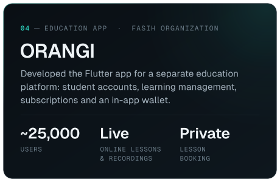

  <picture>
    <source media="(max-width: 767px)" srcset="assets/banner-compact.svg">
    
  </picture>

  I build and ship mobile apps for real businesses — from clean architecture to the App Store and Google Play.

  
  &nbsp;
  

 

## About

I'm a Flutter developer who cares about what keeps an app healthy after launch: clear architecture, dependable integrations, and tests the next developer can trust.

- **ASHAFAQ** — developed the customer, worker and branch-management apps from scratch and keep improving them in production: 15,000+ active users and 14,000+ completed operations across 11 branches in Riyadh.
- **FASIH** — migrated a native education app (~25,000 users) to Flutter on Clean Architecture, integrating the Zoom Meeting SDK for online classes and Firebase Crashlytics, backed by 1,100+ unit and widget tests.
- **ShamFix** — originated the product and led its technical work; built the customer and technician apps, including AI fault diagnosis, while a backend developer built the Laravel API and admin dashboard.
- **ORANGI** — developed the Flutter app for a separate education platform, with live and recorded lessons, private-lesson booking and an in-app wallet.
- **Wassi** — worked remotely with a distributed team based in Germany on a food delivery app for the Syrian market.

B.Sc. Software Engineering · Yarmouk Private University · 2026

## Featured projects

  <picture>
    <source media="(min-width: 1150px)" srcset="assets/projects/ashafaq-wide.svg">
    
  </picture>
   
  
  

  <picture>
    <source media="(min-width: 1150px)" srcset="assets/projects/fasih-wide.svg">
    
  </picture>
   
  
  

  <picture>
    <source media="(min-width: 1150px)" srcset="assets/projects/shamfix-wide.svg">
    
  </picture>

  <picture>
    <source media="(min-width: 1150px)" srcset="assets/projects/orangi-wide.svg">
    
  </picture>
   
  

  <picture>
    <source media="(min-width: 1150px)" srcset="assets/projects/wassi-wide.svg">
    
  </picture>

## Tech stack

<table>
  <tr><td><samp>LANGUAGES &amp; FRAMEWORKS</samp></td><td>Dart · Flutter</td></tr>
  <tr><td><samp>STATE MANAGEMENT</samp></td><td>BLoC · Cubit</td></tr>
  <tr><td><samp>ARCHITECTURE &amp; DESIGN</samp></td><td>Clean Architecture · SOLID · MVVM · MVC</td></tr>
  <tr><td><samp>NAVIGATION &amp; DI</samp></td><td>GoRouter · GetIt</td></tr>
  <tr><td><samp>BACKEND &amp; APIS</samp></td><td>REST API Integration · Laravel REST APIs</td></tr>
  <tr><td><samp>FIREBASE &amp; CLOUD</samp></td><td>Cloud Firestore · Firebase Cloud Messaging · Firebase Crashlytics</td></tr>
  <tr><td><samp>LOCAL STORAGE</samp></td><td>Hive · SQLite (sqflite) · Shared Preferences</td></tr>
  <tr><td><samp>PAYMENTS &amp; SDKS</samp></td><td>Stripe · Zoom Meeting SDK · Maps Integration · AI APIs</td></tr>
  <tr><td><samp>TESTING &amp; QUALITY</samp></td><td>Unit Tests · Widget Tests · Integration Tests · Golden Tests</td></tr>
  <tr><td><samp>CI/CD &amp; DEPLOYMENT</samp></td><td>Codemagic · Shorebird · GitHub Actions · Git</td></tr>
</table>

Technologies used across my projects — not every project uses every item.

## Contact

The quickest way to reach me is email — **[mohamed.alomari.dev@gmail.com](mailto:mohamed.alomari.dev@gmail.com)** — or **[LinkedIn](https://www.linkedin.com/in/mhdalomari)**.
