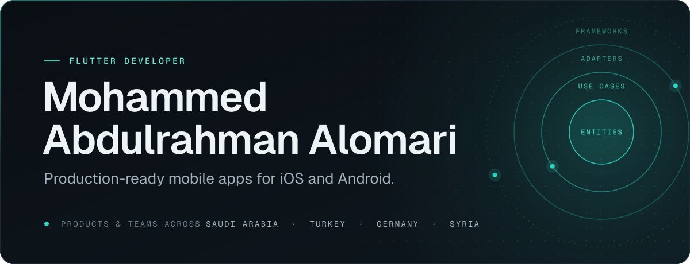
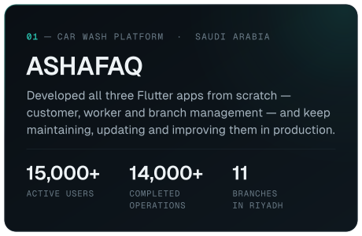
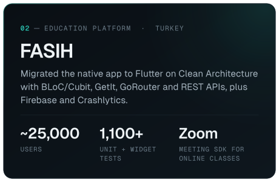
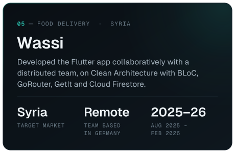

  <picture>
    <source media="(max-width: 767px)" srcset="assets/banner-compact.svg">
    
  </picture>

  I build and ship mobile apps for real businesses — from clean architecture to the App Store and Google Play.

  
  &nbsp;
  

 

## About

I'm a Flutter developer working on products for real businesses: car wash operations across Riyadh, online education in Turkey, home and building maintenance with AI-powered fault diagnosis, and food delivery for the Syrian market.

I care about what keeps an app healthy long after launch — clear boundaries between layers, predictable state, dependable API integration, and code the next developer can extend with confidence.

- **Production apps** — built from the ground up and maintained after launch, live on the App Store and Google Play.
- **Native → Flutter** — migrated an education platform's native mobile app to Flutter, video conferencing included.
- **AI-powered diagnosis** — implemented and tested image and text analysis that classifies the fault, suggests the right service and pre-fills the request, with profanity detection on text input.
- **Team leadership** — initiated ShamFix and led its team through development while building the customer and technician apps.
- **Remote & international** — collaboration with teams across Saudi Arabia, Germany and Syria.
- **Built to last** — automated tests from unit to golden level, and CI/CD-driven releases.

B.Sc. Software Engineering · Yarmouk Private University · 2026

## Featured work

  
  
  
  

  ASHAFAQ is live on <a href="https://play.google.com/store/apps/details?id=com.ashafaq.wash">Google Play</a> and the <a href="https://apps.apple.com/sa/app/ashafaq-%D8%A7%D9%84%D8%B4%D9%81%D9%82-%D9%84%D8%BA%D8%B3%D9%8A%D9%84-%D8%A7%D9%84%D8%B3%D9%8A%D8%A7%D8%B1%D8%A7%D8%AA/id6748883105?l=en">App Store</a>

## Tech stack

<table>
  <tr><td><samp>CORE</samp></td><td>Dart · Flutter</td></tr>
  <tr><td><samp>STATE</samp></td><td>BLoC · Cubit</td></tr>
  <tr><td><samp>ARCHITECTURE</samp></td><td>Clean Architecture · SOLID · MVVM · MVC</td></tr>
  <tr><td><samp>NAVIGATION &amp; DI</samp></td><td>GoRouter · GetIt</td></tr>
  <tr><td><samp>BACKEND &amp; APIS</samp></td><td>Laravel REST APIs · Firebase (Cloud Firestore, Cloud Messaging)</td></tr>
  <tr><td><samp>LOCAL DATA</samp></td><td>Hive · SQLite (sqflite) · Shared Preferences</td></tr>
  <tr><td><samp>INTEGRATIONS</samp></td><td>Stripe · Zoom SDK · Maps · AI APIs</td></tr>
  <tr><td><samp>TESTING</samp></td><td>Unit · Widget · Integration · Golden</td></tr>
  <tr><td><samp>CI/CD &amp; TOOLS</samp></td><td>Codemagic · Shorebird · GitHub Actions · Git</td></tr>
</table>

## Contact

The quickest way to reach me is email — **[mohamed.alomari.dev@gmail.com](mailto:mohamed.alomari.dev@gmail.com)** — or **[LinkedIn](https://www.linkedin.com/in/mhdalomari)**.
